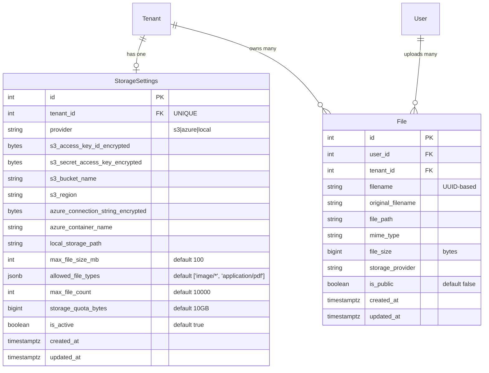

# Data Model: Storage, RBAC & Audit Log Enhancements

**Branch**: `007-storage-rbac-audit` | **Date**: 2026-01-07

---

## Entity Relationship Diagram

---

## Entities

### StorageSettings

**Purpose**: Per-tenant configuration for file storage provider and limits.

| Field | Type | Constraints | Description |
|-------|------|-------------|-------------|
| `id` | `BIGINT` | PK, AUTO | Primary key |
| `tenant_id` | `BIGINT` | FK, UNIQUE, NOT NULL | Reference to tenant (one settings per tenant) |
| `provider` | `VARCHAR(50)` | NOT NULL | Enum: `s3`, `azure`, `local` |
| `s3_bucket_name` | `VARCHAR(255)` | NULLABLE | S3 bucket name |
| `s3_region` | `VARCHAR(50)` | NULLABLE | AWS region |
| `s3_access_key_id_encrypted` | `BYTEA` | NULLABLE | Fernet-encrypted access key |
| `s3_secret_access_key_encrypted` | `BYTEA` | NULLABLE | Fernet-encrypted secret key |
| `azure_container_name` | `VARCHAR(255)` | NULLABLE | Azure container name |
| `azure_connection_string_encrypted` | `BYTEA` | NULLABLE | Fernet-encrypted connection string |
| `local_storage_path` | `VARCHAR(500)` | NULLABLE | Local filesystem path |
| `max_file_size_mb` | `INTEGER` | NOT NULL, DEFAULT 100 | Maximum file size in MB |
| `allowed_file_types` | `JSONB` | NOT NULL | Array of allowed MIME patterns |
| `max_file_count` | `INTEGER` | NOT NULL, DEFAULT 10000 | Maximum files per tenant |
| `storage_quota_bytes` | `BIGINT` | NOT NULL, DEFAULT 10737418240 | Total storage quota (10GB) |
| `is_active` | `BOOLEAN` | NOT NULL, DEFAULT TRUE | Settings enabled flag |
| `created_at` | `TIMESTAMPTZ` | NOT NULL | Creation timestamp |
| `updated_at` | `TIMESTAMPTZ` | NULLABLE | Last update timestamp |

**Indexes**:
- `idx_storage_settings_tenant_id` on `tenant_id` (unique)

**Validation Rules**:
- `tenant_id` must reference existing tenant
- `provider` must be one of: `s3`, `azure`, `local`
- If `provider` is `s3`, then `s3_bucket_name` and `s3_region` required
- If `provider` is `azure`, then `azure_container_name` and `azure_connection_string_encrypted` required
- If `provider` is `local`, then `local_storage_path` required
- `max_file_size_mb` must be between 1 and 1000
- `max_file_count` must be positive
- `storage_quota_bytes` must be positive

---

### File

**Purpose**: Metadata for uploaded files with tenant isolation.

| Field | Type | Constraints | Description |
|-------|------|-------------|-------------|
| `id` | `BIGINT` | PK, AUTO | Primary key |
| `user_id` | `BIGINT` | FK, NOT NULL | Reference to uploader |
| `tenant_id` | `BIGINT` | FK, NOT NULL | Reference to tenant |
| `filename` | `VARCHAR(255)` | NOT NULL | UUID-based unique filename |
| `original_filename` | `VARCHAR(255)` | NOT NULL | Original user filename |
| `file_path` | `VARCHAR(500)` | NOT NULL | Path in storage provider |
| `mime_type` | `VARCHAR(100)` | NOT NULL | MIME type of file |
| `file_size` | `BIGINT` | NOT NULL | Size in bytes |
| `storage_provider` | `VARCHAR(50)` | NOT NULL | Provider used: s3, azure, local |
| `is_public` | `BOOLEAN` | NOT NULL, DEFAULT FALSE | Public visibility flag |
| `created_at` | `TIMESTAMPTZ` | NOT NULL | Upload timestamp |
| `updated_at` | `TIMESTAMPTZ` | NULLABLE | Last update timestamp |

**Indexes**:
- `idx_files_tenant_id` on `tenant_id`
- `idx_files_user_id` on `user_id`
- `idx_files_mime_type` on `mime_type`
- `idx_files_tenant_public` on `(tenant_id, is_public)` for public file queries

**Validation Rules**:
- `filename` must be unique (UUID-based generation)
- `file_size` must be positive
- `mime_type` must match allowed types in tenant's `StorageSettings`

**State Transitions**:
- **Created** → File uploaded, metadata stored
- **Public** → `is_public` set to true, signed URLs available
- **Private** → `is_public` set to false (default)
- **Deleted** → File removed from storage and database

---

### Permission (Extended Enum)

**Purpose**: Granular permission values for RBAC.

| Permission Value | Description |
|------------------|-------------|
| `USER_SELF_READ_AND_WRITE_ONLY` | Access only own profile data |
| `USER_DELETE_ONLY` | Can delete users |
| `USER_ROLE_ASSIGN_OR_REMOVE_ONLY` | Can assign/remove roles from users |
| `MANAGE_BILLING` | Manage billing settings and records |
| `MANAGE_PRODUCTS_AND_PRICING` | Manage products and pricing tiers |
| `MANAGE_STORAGE_SETTINGS` | Configure tenant storage settings |
| `AUDIT_LOGS_VIEW_ONLY` | View audit logs (read-only) |
| `AUDIT_LOGS_DOWNLOAD` | Export/download audit logs |

---

## Relationships

| Parent | Child | Type | Cascade |
|--------|-------|------|---------|
| `Tenant` | `StorageSettings` | One-to-One | DELETE |
| `Tenant` | `File` | One-to-Many | DELETE |
| `User` | `File` | One-to-Many | CASCADE |

---

## Migration Notes

### New Tables
1. `storage_settings` - Per-tenant storage configuration
2. `files` - File metadata with tenant isolation

### Modified Tables
None - No existing tables modified

### Indexes
See entity definitions above for required indexes

### Data Volume Assumptions
- Each tenant: up to 10,000 files (configurable)
- Average file metadata row: ~500 bytes
- `storage_settings`: 1 row per tenant
- Expected query patterns: by tenant_id, by user_id, by mime_type
